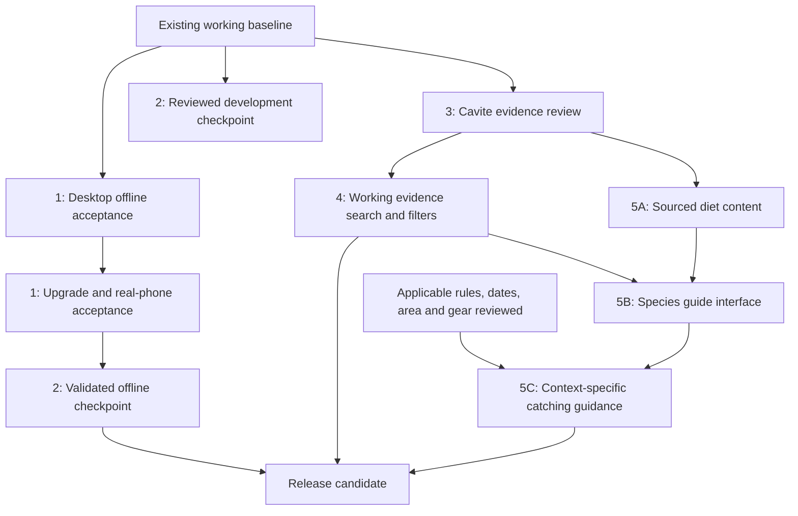

# Bangwit implementation plan

Prepared October 13, 2026 · Cavite pilot · Status: execution in progress

This plan covers the five agreed milestones: offline acceptance, a safe Git checkpoint, Cavite evidence review, working Species search/filtering, and sourced diet/catching guides. The user authorized implementation on October 13, 2026. It does not authorize a deployment, push, agency message, or new data collection from users.

## 1. Outcome and boundaries

Deliver a reliable private catch journal and a useful, searchable Cavite evidence library, then add species guides supported by traceable sources. A user must be able to distinguish an old specimen record, a reviewed biological fact, a personal catch, and a rule applying to their planned activity.

- Keep Next.js App Router, TypeScript, Tailwind CSS, the existing components, Filipino/English support, and Bangwit's current visual identity.
- Keep IndexedDB catches and photo backups readable. No account, GPS collection, cloud sync, or catch-database migration is required for these milestones.
- Preserve all planned filter capabilities. Enable a filter only when its data supports it; show a clear unavailable/unknown state otherwise.
- A historical record does not establish current presence, abundance, catchability, legal access, or food safety. A missing record does not establish absence.
- Do not assign broad coastal records to Manila Bay, Bacoor Bay, or Cañacao Bay without separate locality review. An administrative outline is not a municipal-water boundary.
- Natural diet and effective bait are separate claims. Neither can establish that a method is lawful at a given place and time.
- Other agreed features, including verified legal maps, weather/red-tide alerts and mascot improvements, remain on the roadmap. They are outside these five work packages rather than being removed.

## 2. Recorded baseline

These are existing results and read-only observations, not tests newly performed while writing this plan.

| Area | Current state | Remaining work |
| --- | --- | --- |
| Quality checks | October 13 production build, TypeScript, whole-app lint, focused format and seven offline/storage tests passed. | Repeat the relevant checks after implementation changes. |
| Policy dialog | Desktop/mobile-viewport keyboard scrolling, focus trapping and language reset checked; prototype notice accepted on the isolated test origin after user assent. | Production legal text, real-phone and assistive-technology coverage remain separate checks. |
| Offline reliability | Desktop no-server offline save/reload with a synthetic photo, reconnect draft recovery, cached navigation/fallback, backup/restore, a fresh-origin reload, and a rebuild upgrade were exercised at isolated local origins `4178`–`4180`. The non-empty restore guard also passed. | A brand-new browser profile, physical-device acceptance, and exhaustive outbound-traffic review remain open. See [OFFLINE_ACCEPTANCE.md](<C:/Users/Joseph T Lopez/Documents/Codex/2026-09-27/realtime-voice-chat-3/work/bangwit-next/OFFLINE_ACCEPTANCE.md>). |
| OBIS research | 160 occurrence records; checklist has 78 species-field names, including non-fish; fish-candidate list has 27 entries. | Review identity, license, locality, dates and source duplicates before publication. |
| Published historical evidence | 13 shortlisted CC0 specimens produce 12 published records / 12 accepted taxon IDs; one locality conflict is excluded. Five records concern Limbones Cove, seven broad Cavite/Manila Bay; three collection dates are unknown. | Preserve those exclusions and uncertainty; expand only with reviewed evidence. |
| Provincial report | 11 dated catch groups from the Cavite Ecological Profile 2024. | Keep group/local names separate from exact scientific-species identity. |
| Species controls | Historical snapshot filtering was not connected. | Name, source-locality and dated/undated filters now apply to the labeled 12-record reviewed historical snapshot. Water-type and conservation-status controls remain visibly unavailable. |
| Guides | No reviewed diet/bait/method dataset is published. | Two source-linked diet examples and food-group filtering are published as study-specific education; bait/method guidance remains withheld pending independent evidence and rule review. |

The detailed QA baseline is in [OFFLINE_ACCEPTANCE.md](<C:/Users/Joseph T Lopez/Documents/Codex/2026-09-27/realtime-voice-chat-3/work/bangwit-next/OFFLINE_ACCEPTANCE.md>). Product claims remain governed by [PRODUCT.md](<C:/Users/Joseph T Lopez/Documents/Codex/2026-09-27/realtime-voice-chat-3/work/bangwit-next/PRODUCT.md>).

## 3. Delivery sequence and dependencies

Start desktop acceptance and evidence review independently. If a phone, authoritative rule, or agency reply is unavailable, continue the independent work; keep the affected acceptance/recommendation gate pending. A development commit can record partial progress, but it must not be described as a fully validated offline release.

| Work package | Responsible role | Depends on | Exit deliverable |
| --- | --- | --- | --- |
| 1. Offline acceptance | Developer + human device tester | Existing production build | Case-by-case evidence and bounded product claims |
| 2. Git checkpoint | Developer; repository owner for publication | Reviewed diff and relevant checks | Local commit/build identifiers and rollback notes |
| 3. Cavite review | Data reviewer + developer | Existing sources and explicit review criteria | Reproducible reviewed snapshot plus decision log |
| 4. Species search/filtering | Developer + UX tester | Reviewed snapshot/schema | Functional bilingual evidence explorer |
| 5. Diet/catching guides | Content reviewer + developer; fisheries reviewer for applicability | Accepted taxon identity; sources; reviewed applicable rules for recommendations | Cited diet sections and appropriately gated catching guidance |

One person may fill several roles. A role label does not imply that a reviewer or agency has already approved anything.

## 4. Work package 1 — finish offline acceptance

### Preparation

- Use a production build, a disposable test profile/origin and a fake catch/photo fixture. Keep existing real journals untouched; export a private backup before any real-device testing.
- Record browser/version, device/OS, exact origin, build ID, service-worker installation/control state and test time. Keep the origin unchanged when testing persistence or upgrades.
- Have the human tester review the prototype policies before agreeing. Automation must not manufacture an agreement or bypass the policy gate.
- Test physical phones on a trusted HTTPS production test origin. A phone visiting a desktop's plain LAN HTTP address does not inherit the desktop localhost secure-context exception. If a test deployment is needed, prepare it first and obtain publication approval before deploying.

### Acceptance matrix

| ID | Case | Pass criterion |
| --- | --- | --- |
| O1 | First direct visit and warmed/controlled visit | Record both separately. Once installation/control is ready, offline `/catches` reload opens and hydrates the journal. A failed first attempt remains visible in the results. |
| O2 | Save offline and reload | Photo bytes/viewer, species, date, water type, notes, spot label and nondefault measurement units survive. Identified catches populate My Species; unidentified entries do not. |
| O3 | Reconnect with an unsaved draft | No automatic reload; photo and units remain; saving once creates one entry. Manual reload/tab-close draft recovery is not an existing promise. |
| O4 | Navigation and fallback | Record client navigation and full reload separately. Warmed routes work as observed; an unvisited document request shows the fallback; its journal action opens the actual journal. |
| O5 | Backup, restore and privacy | Offline export/empty-journal restore retains photos and units. Nonempty restore is rejected without changes. Original journal remains intact; catch payloads are not uploaded or placed in service-worker caches. |
| O6 | Build A to B upgrade | Same origin/profile, changed app assets and two recorded build IDs. A's catches survive B; an open draft survives while B waits; after normal old-tab closure/activation, offline journal/fallback hydrate with B's assets. |
| O7 | Physical phone / installed app | Repeat O2/O3 and cold launch on the supported phone/browser and installed home-screen mode where available. Record Android and iOS results separately if both are supported. |

Fix only reproduced failures in the owning layer, then repeat the failed case and a relevant storage/cache regression check. Record pass, fail, not run or not supported for every case. Do not turn viewport screenshots or simulated IndexedDB tests into device acceptance.

**Deliverables:** completed case log in OFFLINE_ACCEPTANCE.md, reproducible defects/fixes if needed, private test fixtures/backups, and updated README/PRODUCT wording limited to proven behavior. Release upgrades and real-device coverage stay pending until actually exercised.

### HTTPS phone-test preparation — October 14, 2026

The next-step request has produced a Vercel Preview configuration, matching Node.js 24.x engine metadata, a CLI upload allowlist, a worker update-cache header and a read-only HTTP hosting checker. Production build, five offline-cache tests and local hosting checks passed. [STAGING_ACCEPTANCE.md](STAGING_ACCEPTANCE.md) contains account/setup requirements and separate browser/installed-app phone cases. Vercel account connection is not yet confirmed; a hosted URL and physical-phone results remain pending. Existing October 13 browser results retain their recorded build scope.

## 5. Work package 2 — create safe checkpoints

1. Review the current uncommitted policy/documentation work and screenshots before selecting a commit boundary. Treat existing `next-env.d.ts` changes as generated/user workspace state to inspect, not something to overwrite blindly.
2. Stage an explicit reviewed file list. Inspect staged content for `.env` values, API credentials, private catches/photos/backups, build artifacts and raw files without redistribution rights. `.gitignore` alone is not proof that a file is safe to publish.
3. Run relevant existing checks on the final code state: lint, TypeScript, focused format, offline/storage tests, evidence tests when data changes, and production build. Resolve new failures without unrelated refactoring.
4. Create a local development checkpoint with known limitations. After O1–O7 reach the agreed supported-device gate, create a separate validated checkpoint and record its commit/build IDs.
5. Include the generated public snapshot, its reviewed reproducible inputs and attribution. Document how to reacquire ignored research originals; a clone must not silently depend on one person's Downloads folder.

**Rollback:** retain the previous validated commit/build and source snapshot. Restore code/data through Git without clearing browser storage; verify worker activation and catch/photo readability. If a future storage-schema change becomes necessary, plan backup/backward readability before implementing it.

**Exit gate:** the checkpoint is reproducible and its limitations are documented. Pushing, tagging a public release and deploying are separate explicit repository-owner actions; this planning request does not perform them.

## 6. Work package 3 — review Cavite evidence

### R1. Review the finite existing queue

- Audit the 27 fish-candidate entries and their linked occurrences. Record an include, exclude or unresolved decision with reasons; do not promise that all 27 will qualify or that there will be a minimum number of new published species.
- Recheck the existing 12 published historical records against their source/accepted-name mapping and preserve the rejected locality. Do not remove an exclusion merely to increase coverage.
- Track provider, dataset, original occurrence/catalog ID, accepted authority ID, recorded name/synonyms, locality text, coordinate uncertainty, collection-date precision, license/citation, reviewer and review time.
- Distinguish collection date, source publication/update date, retrieval time and review time. Keep unknown and month-only dates intact.
- Review existing provider water-type flags before using them. Do not infer water type, native/invasive status or protection from a fish class, common name or vague coastal locality.

### R2. Expand sources only where needed

Use the existing OBIS export, WoRMS crosswalk, license/locality reviews and direct-source catalog first. If gaps remain, define a bounded GBIF/OBIS query for the relevant Cavite land/freshwater or coastal research scope; retain its query, retrieval metadata and coverage limits. Deduplicate overlapping portals by original identifiers/dataset/catalog provenance, not just coordinates or names.

Reconfirm current access and reuse terms when retrieving new material. Public lookup access does not grant rights to redistribute every occurrence, photograph or text. Do not require an account/API credential where a verified public read endpoint suffices; do not embed private credentials in client bundles.

Keep the first publication batch within the existing reviewed CC0 scope. If another license or provider must be admitted, explicitly update attribution and per-record/per-dataset gates before generating the new projection. Never bypass the current one-dataset validation by appending unrelated rows to its CSV.

### R3. Produce the reviewed projection

- Separate stable taxon identity from evidence records as additional sources are admitted. Namespace authority IDs; keep original identifiers and synonyms. A provincial common catch group is not automatically a taxon match.
- Preserve per-source citation/license and explicit locality/time review states. Current provider/locality-specific validation should become explicit reviewed configuration only where actual new sources require it; avoid a generic ingestion platform.
- Generate a deterministic browser-facing snapshot from the reviewed inputs. Invalid or conflicting provenance, licenses, dates, taxonomy or unknown review states must stop publication or leave the row unresolved in research.
- Keep broad historical regional evidence separate from selected-bay verified-data gaps. No precise point, sanctuary assignment or legal geometry is produced from coarse uncertainty.

**Exit gate:** every published record has an auditable decision and adequate rights/provenance; unresolved records remain outside the published result; regeneration matches the checked-in snapshot. Zero newly eligible records is a valid research outcome, not a reason to relax gates.

## 7. Work package 4 — implement Species search and filters

### S1. Ship truthful filters over the current reviewed evidence first

Use a small pure selector over the existing snapshot. Search accepted scientific names, recorded names/synonyms, and reviewed common-name aliases only where supplied. Start with broad source-locality and dated/undated filters; introduce evidence-type selection only when the UI actually contains more than one supported type.

- Label the controlled dataset clearly as reviewed historical/regional evidence. Show separate species and record counts, using accepted taxon IDs for species counts.
- Combine filters predictably, provide clear/reset actions and announce result changes accessibly. An empty match means no matching reviewed records, not no fish at the location.
- Keep source details, date precision, uncertainty and review limitations available in the results. No result should gain a catchable badge from taxonomy acceptance.
- Preserve selected-area context, but do not automatically restrict province/coastal history to a bay that the record cannot substantiate. Explain the scope mismatch beside the results.

### S2. Enable additional dimensions only after review

Retain the planned water/status capabilities with a clear unavailable state until reviewed values exist. When supported, include an explicit unknown category. Separate biological establishment/invasiveness from legal protection; these are not mutually exclusive statuses. A protected species may still have documented presence, so its evidence is not erased by a recommendation restriction.

Use the established DropdownSelect, native controls where already appropriate, current design tokens and progressive disclosure. Keep search/results compact on mobile, usable by keyboard, and translated in both dictionaries. Do not add a new search service, UI library, database or server API for the small reviewed snapshot.

**Exit gate:** controls demonstrably filter their named dataset; combination/reset/no-match states work; unknown attributes stay truthful; source details remain reachable; catches/My Species are unaffected.

## 8. Work package 5 — sourced diet and catching guides

### G1. Establish a curated content model and finite starter batch

Select up to five taxa with confirmed identity and usable sources, based on relevance and evidence availability. Document the selection; do not choose them merely because they have familiar local names. Start smaller if fewer qualify.

| Content object | Required information |
| --- | --- |
| Taxon link | Accepted authority ID and source-backed scientific name; common-name ambiguity remains visible. |
| Diet claim | Documented food/prey category, life stage, habitat/location context, claim-level source and locator, review date and reuse/attribution notes. Unknown context stays unknown. |
| Method/bait claim | Separately documented method or bait, applicable gear/setup and context, source, limitations and review decision. A prey item is not automatic bait evidence. |
| Applicability record | Jurisdiction/place, activity/fisher category, gear, target taxon, relevant date/season, official source/section, effectivity/amendment review, and explicit unresolved conditions. |

Candidate references include original research, fisheries/extension material, and species-reference works such as FishBase, subject to source and reuse review. These are research candidates, not currently integrated diet APIs or already approved content. Use short attributed summaries rather than copied pages or unlicensed images.

### G2. Publish educational diet information independently

Add an “What it eats / Ano ang kinakain?” section to the reviewed species detail. Provide concise sourced claims, context and unknown/conflicting states. Diet-category filtering becomes available only for reviewed claims; avoid universal statements such as all individuals always eating the same prey.

Diet information may be published before precise municipal-water GIS is available, because it is not a claim that fishing is permitted at a spot. It must not silently become a bait recommendation.

### G3. Gate location-specific catching recommendations

- Ask for place, trip date, gear and fisher/activity category when the user requests contextual catching advice; reuse optional profile preferences without treating them as proof of eligibility.
- Default applicability to `not_verified`. An unavailable or incomplete rule source must not produce an allowed/safe answer.
- Evaluate relevant species/gear/area restrictions, closure dates, permit/eligibility conditions and amendment/effectivity status using reviewed official sources. Unknown jurisdiction or ambiguous boundary means contextual recommendations remain unavailable.
- If the reviewed context is restricted, show the relevant source-backed restriction and withhold the incompatible recommendation. If sufficient applicable rules and method evidence have been reviewed, show qualified guidance with its sources/context and no catch guarantee.
- Prepare the guide interface, content review and unknown/restricted states while awaiting missing official information. A separate complete legal boundary dataset is not required for every general biology task, but spatial legality must never be guessed.
- Cached guidance retains its source/review/validity information. Offline copies cannot newly confirm current legal or safety conditions; stale or unavailable applicability withholds a fresh contextual recommendation.

**Exit gate:** each diet/method claim is sourced separately; taxon links are correct; context/unknown/conflict states are visible; unsupported or restricted catching advice is withheld. If legal applicability remains unresolved, diet/research UI can ship with catching recommendations explicitly pending. Work package 5's recommendation portion is not complete until that gate is satisfied.

## 9. Implementation map and focused proof

| Work | Existing files/components to use | Planned additions only when needed |
| --- | --- | --- |
| Offline QA | [Acceptance log](<C:/Users/Joseph T Lopez/Documents/Codex/2026-09-27/realtime-voice-chat-3/work/bangwit-next/OFFLINE_ACCEPTANCE.md>), [precache](<C:/Users/Joseph T Lopez/Documents/Codex/2026-09-27/realtime-voice-chat-3/work/bangwit-next/src/lib/offline-precache.ts>), [worker](<C:/Users/Joseph T Lopez/Documents/Codex/2026-09-27/realtime-voice-chat-3/work/bangwit-next/src/app/sw.ts>), [catch storage](<C:/Users/Joseph T Lopez/Documents/Codex/2026-09-27/realtime-voice-chat-3/work/bangwit-next/src/lib/storage/catches.ts>) | Case evidence and reproduced-defect fixes; no speculative persistence rewrite. |
| Data review | [OBIS research inventory](<C:/Users/Joseph T Lopez/Documents/Codex/2026-09-27/realtime-voice-chat-3/work/bangwit-next/data/research/obis/cavite/README.md>), [alternative-source inventory](<C:/Users/Joseph T Lopez/Documents/Codex/2026-09-27/realtime-voice-chat-3/work/bangwit-next/data/research/alternatives/cavite/README.md>), [generator](<C:/Users/Joseph T Lopez/Documents/Codex/2026-09-27/realtime-voice-chat-3/work/bangwit-next/scripts/build-cavite-historical-evidence.mjs>), [snapshot](<C:/Users/Joseph T Lopez/Documents/Codex/2026-09-27/realtime-voice-chat-3/work/bangwit-next/src/data/cavite-historical-evidence.json>) | Review decisions and explicit additional-source/schema support. |
| Species UX | [Species page](<C:/Users/Joseph T Lopez/Documents/Codex/2026-09-27/realtime-voice-chat-3/work/bangwit-next/src/app/species/page.tsx>), [historical component](<C:/Users/Joseph T Lopez/Documents/Codex/2026-09-27/realtime-voice-chat-3/work/bangwit-next/src/components/historical-species-evidence.tsx>), [dropdown](<C:/Users/Joseph T Lopez/Documents/Codex/2026-09-27/realtime-voice-chat-3/work/bangwit-next/src/components/dropdown-select.tsx>) | Small pure selector; dictionary/type additions; no new search infrastructure. |
| Guides | Existing source/review patterns, Species detail disclosure and bilingual dictionaries | Curated guide dataset/types, review validator and applicability selector; a dedicated route only if the detail flow needs it. |
| Regression proof | [Historical evidence tests](<C:/Users/Joseph T Lopez/Documents/Codex/2026-09-27/realtime-voice-chat-3/work/bangwit-next/tests/historical-evidence.test.mjs>), [storage tests](<C:/Users/Joseph T Lopez/Documents/Codex/2026-09-27/realtime-voice-chat-3/work/bangwit-next/tests/catches-storage.test.mjs>), [precache tests](<C:/Users/Joseph T Lopez/Documents/Codex/2026-09-27/realtime-voice-chat-3/work/bangwit-next/tests/offline-precache.test.mjs>) | Focused selector and guide-gate tests; extend data tests for admitted sources. |

Required new proof should cover:

- Taxonomy synonyms/authority identity, cross-provider duplicate detection, license/provenance failure, excluded localities and unknown/month-only dates.
- Case/diacritic handling for reviewed names, combined filters, unknown attributes, zero matches, reset and correct species-versus-record counts.
- Missing source/context, conflicting rules, stale applicability, protected/restricted contexts and the separation of diet from bait/method claims.
- Filipino/English, desktop/mobile layouts, keyboard dropdown/disclosure use, screen-reader result labels, and no changes to catch persistence or My Species derivation.

Run only checks relevant to the actual slice, followed by a production build for browser acceptance. Do not add tests that only repeat the implementation or repeatedly rerun passing suites without a new change/failure.

## 10. Risks and release decisions

| Risk or dependency | Mitigation / decision |
| --- | --- |
| Phone or reviewer unavailable | Continue desktop/data/UI work; keep the missing acceptance or content gate explicitly pending. |
| No additional publishable Cavite records | Ship useful search over the existing reviewed evidence and report the data gap; do not invent records or loosen rights/locality criteria. |
| Marine data mistaken for whole-province coverage | Review inland/freshwater and coastal scope separately. Never describe the OBIS subset as a complete Cavite inventory. |
| Common names resolve to several taxa | Preserve unresolved group identity and show sourced alternatives; do not auto-select one species. |
| New source version changes bytes or taxonomy | Preserve prior snapshot, review changed facts/rights, regenerate deterministically and run focused checks before replacing public data. |
| Missing or conflicting legal applicability | Continue sourced biology and legal-reference research; withhold contextual catching recommendations. Agency replies are one evidence route, not a gate for all development. |
| Offline cached information becomes stale | Retain original dates and source context; do not convert last-known information into current clearance or safety. |
| Public deployment changes privacy/security practices | Review Terms/Privacy and actual data practices before launch; API keys, accounts, analytics and cloud sync require their own implementation/privacy work. |

### Completion checklist

- [ ] O1–O7 offline/reconnect/upgrade/device acceptance completed for the declared supported devices/browsers.
- [x] Desktop O1 controlled offline reload on a fresh origin, O2 save/reload with synthetic photo, O4 cached route/fallback, O5 offline export/restore and non-empty restore rejection, and O6 rebuild-upgrade checks passed to their recorded scope. O3 reconnect-draft recovery is partial. A brand-new browser profile, physical phone, and exhaustive outbound-traffic review remain pending.
- [x] Local development checkpoint created as commit `f25a84a`; no push or deployment.
- [ ] Validated offline checkpoint after O1–O7 acceptance remains pending.
- [x] Existing candidate queue has a deterministic, auditable record ledger; published evidence retains identity, rights, dates and locality limits. Remaining candidate rows stay pending rather than being treated as accepted or published.
- [x] Species name/locality/date controls filter the labeled reviewed dataset and handle counts/reset/no-match states. Water-type and status remain explicitly unavailable until values are reviewed.
- [x] Starter diet claims have sources and study context. Method/bait claims do not yet have independent support, so recommendations remain withheld.
- [ ] Applicable restrictions/unknowns are enforced before contextual catching guidance is available.
- [x] Relevant final source checks, production build, and Species-route smoke check pass. The prototype notice was accepted on the isolated test origin after user assent; this does not approve production legal text.

Status on October 13, 2026: the functional Species filters, source-linked diet sample, finite candidate ledger, final source checks, production build, local development checkpoint, and recorded desktop offline cases are complete to their documented scope. Commit `f25a84a` is local and has not been pushed. Desktop fresh-origin and rebuild-upgrade behavior passed; a brand-new browser profile, physical phone, and exhaustive outbound-traffic review remain open. Contextual catching advice remains unavailable until independent method evidence and current applicable official rules are reviewed. Five clearly marked synthetic test catches remain on each isolated local origin `127.0.0.1:4178` and `127.0.0.1:4179`; the 4179 journal was restored from the private offline backup, and its non-empty restore guard was verified. No real catch data was used.
