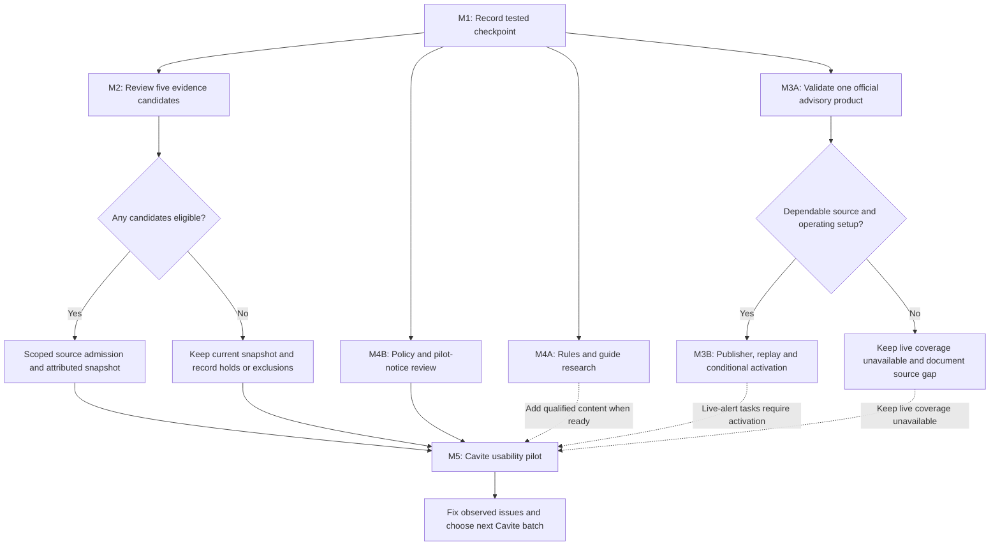
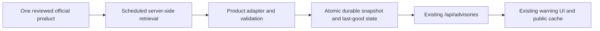

# Bangwit: Cavite data and pilot implementation plan

Prepared: 17 October 2026. Status: execution in progress; dated outcomes are recorded in section 12.

## 1. Outcome and starting point

Deliver a more useful, source-backed Cavite library, a validated first live-advisory integration if a suitable source qualifies, aligned policies, and a small Cavite usability pilot. Use the existing Next.js App Router, TypeScript, Tailwind CSS, Serwist, bilingual UI and device-local catch journal.

The user reports that the planned functional tests passed, including mobile, dropdown and installed-app checks. Treat that as the completed functional checkpoint, with the evidence limits already recorded in [OFFLINE_ACCEPTANCE.md](../OFFLINE_ACCEPTANCE.md) and [STAGING_ACCEPTANCE.md](../STAGING_ACCEPTANCE.md). Do not restart the full acceptance suite for this plan; test relevant behavior when subsequent changes justify it.

Repository observations for planning, rather than newly performed functional tests:

| Area | Starting point | Next deliverable |
| --- | --- | --- |
| Release | Local HEAD `2d8fbcf` records the reported full test pass. Hosted identities have separate historical records. | Reconciled release record tying a reviewed source state to its actual deployed build. |
| Species evidence | 12 published historical CAS CC0 records. The finite ledger contains 52 occurrences under 27 candidate names: 12 published, 2 excluded, 38 pending. Four pending occurrences have curator holds. | Five documented candidate-review decisions; publication only for independently eligible records. |
| Publication pipeline | One reviewed CAS dataset and CC0-only admission, with shared dataset attribution. No pending row meets that existing gate. | Preserve the current gate; adapt it for one additional reviewed source only if a qualifying batch exists. |
| Guides | Two attributed diet examples; water/status facets and contextual catching advice remain unavailable. | Up to three additional qualified diet examples, plus independently reviewed rule/method references. |
| Advisories | Existing normalized API, validation, fictional preview, public cache and warning UI. No validated raw official-source adapter or operational publisher. | One reviewed Cavite product, with scheduled ingestion, durable state and conditional activation. |
| Policies and pilot | Draft bilingual policies; operator/hosting facts and pilot success measures need completion. First-round audience selected: mixed beginner and experienced fishers. | Reviewed notices, a minimal feedback procedure and a measured pilot. |

Source leads and reuse terms in existing research notes must be checked again during implementation. This planning pass does not establish current official-feed availability, current law or new publication rights.

## 2. Product rules that continue through every milestone

- Keep personal catches/photos in the current browser profile. This work does not require accounts, GPS, cloud catch sync, public catch sharing or a catch-storage migration.
- Separate historical occurrence, biological facts, personal catches, legal applicability and safety advisories. Historical records do not establish current presence or permission to fish; missing records do not establish absence.
- Preserve the four existing curator holds and two exclusions. Keep original identifiers, date precision, uncertainty, citations and licenses. A review can legitimately produce zero newly publishable records.
- Keep the existing map's source year and geography limits visible. Province outlines cannot supply municipal-water, sanctuary, access or legal fishing boundaries.
- Reuse `.ui-card`, `.ui-button`, `.ui-input`, `DropdownSelect` and `CatchDatePicker` under [AGENTS.md](../AGENTS.md) and [DESIGN.md](../DESIGN.md). Maintain compact layout, Filipino/English copy, keyboard/touch access, light/dark themes and reduced motion.
- Retain all planned features on the roadmap. BFAR red tide/shellfish advisories and national coverage need their own source, geography and semantic review; they are later integrations, not rainfall categories.

## 3. Work breakdown and dependencies

| ID | Work package | Main responsibility | Depends on | Done when |
| --- | --- | --- | --- | --- |
| M1 | Record the tested checkpoint | Developer + repository owner | Existing acceptance report | Source, deployment, evidence and rollback references agree. |
| M2 | Review and expand Cavite evidence | Data reviewer + developer | M1 baseline | First five decisions are durable; any publication is reproducible and properly attributed. |
| M3 | Build one real advisory integration | Developer + source/domain reviewer | Source feasibility; M1 baseline | A reviewed Cavite product passes operational and deployment gates, or a documented no-go leaves coverage unavailable. |
| M4 | Complete fishing references and policies | Content reviewer + operator + qualified policy reviewer | Source research; actual hosting/publisher facts | Claims and bilingual notices match evidence and actual processing. |
| M5 | Run the Cavite usability pilot | Project owner + facilitator + participants | M1, reviewed starter content, M4 policy/pilot-notice gate | Findings, priority fixes and a release/next-batch decision are recorded. |

Solid arrows show required gates; dotted arrows show optional content or advisory-scope inputs. M2, source feasibility and policy fact-gathering can proceed in parallel. An education/journaling pilot can proceed with explicitly unavailable live coverage while M3 remains in progress. A pilot that claims working live alerts additionally requires M3's activation gate. Agency replies and national municipal-water GIS do not block every work package.

## 4. M1: Record the tested checkpoint

1. Reconcile README, PRODUCT and the older implementation checklist with the latest acceptance report. Correct stale `39 pending / 1 excluded` wording to the generated ledger's `38 / 2`; preserve older dated test results as history.
2. Record the reviewed commit, deployed commit/build, exact URL, acceptance-report date and available device/browser context. Leave unavailable details explicitly unrecorded rather than inferring them from HEAD.
3. Inspect generated workspace changes, including `next-env.d.ts`, without folding unrelated changes into the checkpoint. Review an explicit file list for secrets, raw research rights, private backups and photos before any repository publication.
4. Prepare a concise release note and rollback reference. Restore code/public data through Git and the previous deployment; do not clear browser journals as a rollback method.
5. When a checkpoint is actually committed or deployed, record the resulting identifiers. Tagging, pushing and deploying must follow the repository owner's existing instructions, rather than being implied by writing this plan.

Deliverable: [release baseline record](releases/cavite-pilot-baseline.md), plus reconciled status documents. The record distinguishes the last previously verified deployment from the present checkout and the user's reported tests.

Acceptance: the recorded source/deployment relationship is verifiable, reported and independently observed checks remain distinguished, and the rollback instructions preserve personal journals.

## 5. M2: Review and expand Cavite species evidence

### M2.1: Review the first five records

Review these five currently untouched candidates as a finite research batch:

| Recorded candidate name | Provider | OBIS occurrence ID |
| --- | --- | --- |
| *Nuchequula blochii* | Smithsonian | `9f16eeaa-9c50-4cad-97f9-5a728254ea1f` |
| *Ostorhinchus fasciatus* | Smithsonian | `0283ab44-b1e8-4ed4-9e11-2cff048300aa` |
| *Ostorhinchus pleuron* | Smithsonian | `dd7c909e-e8e5-4fae-b768-eea845e2de83` |
| *Ostracion rhinorhynchos* | National Museum Philippines | `de331418-cfe9-4e0a-9797-8f2512729ad5` |
| *Stolephorus indicus* | National Museum Philippines | `6ad5b3c0-daee-4db4-b1fb-1ea45f32e912` |

Their occurrence-license fields are blank in the current export; the dataset review lists CC-BY 4.0, and individual locality decisions are absent. These are review candidates, not approved taxa or approved publication inputs. Remaining pending records also include NC-licensed sources; do not admit those under the existing CC0 gate.

For each record:

1. Match the original catalog record and provider identity; retain cross-portal identifiers so GBIF/OBIS copies do not become duplicate evidence.
2. Verify the actual reuse basis, dataset/record relationship, attribution and any image rights. A dataset label alone must not silently fill a missing record-level review.
3. Check accepted authority ID, recorded name/synonyms, collection date and precision, locality text, uncertainty and any conflicting coordinates.
4. Record the evidence URLs/locators, retrieval/review dates, reviewer, decision and reason. Keep unresolved records on hold; exclude only the affected occurrence with an explicit rationale.
5. Regenerate the research ledger and reconcile counts. An eligible-for-admission proposal belongs in review evidence until a supported publication representation exists; do not invent an approval value that current scripts cannot process.

### M2.2: Conditional publication, not automatic gate relaxation

If no candidate qualifies, retain the 12-record public snapshot and deliver the five review decisions. A later bounded CC0 source query is an independent research option, with recorded query/coverage/rights and no promised result count.

If a non-CC0 candidate qualifies, first implement admission for one actual reviewed source batch:

- Add explicit reviewed source/license configuration and a durable approval representation, while preserving holds and exclusions.
- Replace the assumption of one shared dataset citation with per-record source/dataset references and required attribution. Keep existing CAS records and their source context readable.
- Update the deterministic generator, validation and historical-evidence renderer together. Do not append foreign rows to the current CC0 shortlist to bypass validation.
- Retain unknown/month-only dates, namespaced authority IDs, source locality and deduplication by original provenance. Publish no precise bay/map assignment from broad or uncertain locality.
- Enable water-type or conservation attributes only when those specific values have independent reviewed sources; retain an unknown category. Taxonomic acceptance alone does not supply these attributes.

Primary existing files: `data/research/obis/cavite/cavite-obis-curator-review.csv`, `cavite-obis-location-review.csv`, `cavite-obis-dataset-license-review.csv`, `cavite-obis-worms-crosswalk.csv`, `scripts/build-cavite-fish-candidate-review.mjs`, `scripts/build-cavite-historical-evidence.mjs`, `src/data/cavite-historical-evidence.json`, `src/components/historical-species-evidence.tsx` and `src/lib/species-research.ts`.

Deliverables: review evidence for five occurrence IDs, regenerated ledger, and either an unchanged public snapshot with reasons or an eligible attributed projection plus scoped generator/UI changes.

Acceptance: every published record has traceable identity, rights and locality review; holds/exclusions cannot bypass admission; regeneration matches the committed snapshot; record/taxon counts and filters remain truthful. There is no minimum number of new published species.

## 6. M3: Connect one real Cavite advisory product

### M3.1: Source feasibility and selection

Evaluate one Cavite rainfall-warning product first, using the official PAGASA publishing lead already recorded in [MAP_ADVISORIES.md](MAP_ADVISORIES.md). Confirm current endpoint/access stability, reuse conditions, update cadence, locality coverage, native categories, issuance/expiry and cancellation/update semantics. This is a candidate product, not a verified available API.

Write a short go/no-go source assessment and field mapping. Reject guesses from screenshots, map colors or unofficial mirrors. If reliable access cannot be validated within the initial research timebox, retain official links and unavailable coverage, record the blocker, and continue M2/M4/M5's education scope.

### M3.2: Small publisher architecture

Use the existing version-1 normalized contract and API instead of replacing the warning UI:

1. Choose one scheduler and durable snapshot store after checking current platform support, cost and permissions. The job must run independently of visitors. Use a small single-product module; do not provision a general ingestion platform.
2. Map official categories, forecast/observed wording and named Cavite municipalities explicitly. Retain stable alert identity, official source link, original issue/effective/expiry times and reviewed bilingual summaries.
3. Validate before atomic publication. Prevent overlapping or older runs from overwriting newer accepted state; preserve cancellation/superseding references and source coverage.
4. Keep durable last-good records across job restarts. Fetch/parse failure means unavailable/stale coverage, not a healthy empty publication. Do not change old bulletin issue dates to make them look current.
5. Define polling cadence, timeout/retry, maximum staleness and publication-to-display expectations against the actual product. Review the existing 10-minute freshness rule and server cache rather than assuming they suit every feed.
6. Assign an operating owner and document last-success monitoring, missed-run/failure notification, source rollback and disable-live procedures. Browser localStorage is not the publisher's durable store.

### M3.3: Activation gate

- Replay real, attributable source examples for partial locality, severity changes, explicit cancellation, unchanged old bulletins, missing feeds, parse errors, future/regressed times and overlapping updates. Publish only permitted fixture material.
- Verify scheduler restart/failure recovery, durable last-good behavior, atomic replacement, measured source latency and deployed HTTPS/offline/reconnect behavior for this new integration.
- Enable only the reviewed product and Cavite coverage. The overall map must not imply all five hazards were checked from a single rainfall source. Preserve unavailable states for every unchecked hazard.
- Keep fictional preview data separate from live snapshots and backups. BFAR red tide requires later source and schema/meaning work; current PAGASA-only validation cannot enable it through environment settings alone.
- After source/contract review, configure `BANGWIT_ADVISORY_FEED_URL` and `BANGWIT_ADVISORY_FEED_REVIEWED` server-side in the controlled test deployment to perform integration acceptance. Production stays unavailable until the activation gate passes; then configure its reviewed feed and update actual coverage/privacy copy.

Existing integration paths: `src/app/api/advisories/route.ts`, `src/lib/map-advisories.ts`, `src/components/use-map-advisories.ts`, `src/components/area-explorer.tsx`, `src/app/sw.ts` and `tests/map-advisories.test.mjs`. Proposed new artifacts: a source assessment/field mapping, one adapter/job module, permitted replay fixtures and an operations runbook. Choose exact paths after inspecting the selected source.

Acceptance: an active product is traceable, correctly scoped and timely to its reviewed operating policy; outage/unknown coverage cannot become an all-clear; an owner can disable or recover ingestion. A documented no-go completes feasibility only, not live integration.

## 7. M4: Fishing references, guides and policies

### M4.1: Qualified fishing information

1. Start with the existing [Cavite rule-source inventory](../data/research/obis/cavite/cavite-fisheries-rule-source-inventory.md). Recheck official full texts, later amendments, effective dates and the relevant activity/gear/area scope before summarizing them.
2. Build concise source-reference cards with jurisdiction, issuer, instrument/section, dates, source locator, review date and unresolved applicability. An incomplete reference may say what still needs checking; it cannot answer that fishing is permitted.
3. Review up to three additional diet taxa, for a maximum starter set of five including the existing two. Record claim-level source, study location, life stage/context, food group, locator and reuse notes. Keep non-Cavite studies labeled accordingly.
4. Research bait/gear/method claims independently. Natural prey is not proof of effective bait. Keep `catchingAdviceStatus` unreviewed/unavailable unless method evidence and current contextual rule review both qualify.
5. Show contextual recommendations only when place, date, activity/fisher category, gear and target identity can be evaluated. Missing boundary or applicability facts stay `not_verified`; do not infer legality from an administrative polygon or a source record.

Reuse `src/data/feeding-guides.json`, `data/research/feeding-guides-review.md`, `src/components/feeding-guides.tsx` and existing Species components. Add a small reference-card content shape only when reviewed material needs it. New food-safety/edibility advice is not supplied by this diet work.

### M4.2: Policies that match actual operation

1. Record Joseph Lopez as the individual project operator for planning and `tepezzzz070@gmail.com` as the dedicated Bangwit public privacy/support route provided by the project owner. Confirm that the mailbox is active and monitored; do not put the private NAMRIA-inquiry email in app copy or participant materials. Have a qualified reviewer confirm the responsible operator/controller wording before approving the notice.
2. Inspect actual hosting/publisher logging, recipients, retention settings and any log drains. Document public request/advisory metadata separately from local catch/photo contents; include future publisher infrastructure only when selected.
3. Resolve purposes, applicable processing basis, retention and rights/contact procedures with the responsible operator and qualified reviewer. Treat these as review tasks, not legal conclusions supplied by this plan.
4. Align Filipino and English Terms/Privacy, including known flood/protected-area, bait/diet and backup-location wording differences and the review banner. Add reviewed document version/effective date and accurate advisory-cache behavior.
5. If material changes need a new acknowledgment, update the existing policy-version handling in `src/components/bangwit-provider.tsx` without deleting catches, photos, preferences or backups. Decide reacknowledgment behavior with the reviewer; a page visit is not fabricated consent.
6. Prepare a separate optional pilot-feedback/recording explanation. Start with minimal deidentified notes outside the app; analytics or new user-data services require their own scope and privacy review.

Primary files: [PRIVACY_REVIEW.md](../PRIVACY_REVIEW.md), `src/i18n/dictionaries/en.ts`, `src/i18n/dictionaries/fil.ts`, `src/components/policy-document.tsx`, and the existing Terms/Privacy routes.

Acceptance: reference claims retain scope and unknowns; guides have independent support; bilingual notices match verified processing facts and have responsible review before broader pilot promotion. Source counts or passing software tests do not substitute for content/policy review.

## 8. M5: Small Cavite usability pilot

### Preparation

Working facilitator and synthetic-data materials: [Cavite pilot session guide](CAVITE_PILOT_SESSION_GUIDE.md). This is not recruitment authorization or a substitute for the pending reviewed pilot notice.

- Recruit a proposed 5–8 Cavite participants across the selected mixed beginner and experienced-fisher audience. Use only a broad self-described experience category to interpret feedback; do not collect livelihood details unless separately justified and approved; this small sample is usability discovery, not representative market validation. No participants have been recruited.
- Keep both beginner and experienced fishers represented in this first round and retain both audiences in the product roadmap. The audience choice does not authorize recruitment or replace the reviewed-notice and privacy/contact gates.
- Include a first-visit guide task: follow the spotlight steps, use Back/Next, skip or finish, then reopen the guide from Help. Record whether users can resume/replay it and whether it helps without interrupting; compare only broad beginner/experienced categories and report raw counts.
- Use one fixed tested release/URL per round, reviewed pilot notices and a short facilitator script. Use synthetic catch/photo values for observed tasks; keep any voluntary real catches or precise locations private.
- For an education/journaling round, keep unavailable alerts and historical-record limits explicit. Live-alert task claims require M3 activation; simulated scenarios remain clearly labeled.

### Session tasks and proposed exit targets

| Task or outcome | Record | Proposed pilot target |
| --- | --- | --- |
| Use and revisit the first-time guide | Unassisted tour discovery, Back/Next/Skip/Finish, Help replay, interruption or confusion | At least 80% complete and reopen unassisted; report raw counts by broad experience group. |
| Choose Cavite and find a species/source | Completion without facilitator help; confusion points | At least 80% complete each critical discovery task; report raw counts too. |
| Interpret old evidence and warning coverage | Answers about historical/current, partial/stale/unavailable states | No unresolved interpretation that turns a data gap into permission or safety clearance. |
| Save a catch/photo offline and reopen it | Successful save/reload, units/photo readability, time to first save | At least 80% complete unassisted; zero unresolved saved-data loss. |
| Understand My Species | Identified versus unknown catch behavior | Collection meaning is understood without implying verified regional presence. |
| Back up a journal | Download success and understanding that it is private | At least 80% complete unassisted; no participant data published. |

These are proposed usability exit targets, not already measured results or statistical claims. Agree the task wording before the first session; record failures and assisted completions separately. Restore testing uses a separate authorized empty synthetic journal, never a participant's populated journal.

Deliverables: deidentified session notes, device/browser/build context, task counts, prioritized issue list and a short pilot report. A prototype UI can be tested; a live-safety claim needs its own data gate.

Decision after the round: fix journal loss and dangerous interpretation issues first, then common task blockers, then visual/copy refinements. Choose the next Cavite content batch from observed needs. National expansion follows province-specific source/geography review rather than copying Cavite assumptions across the current 2020 outline map.

## 9. Validation matched to actual changes

| Change | Focused proof during implementation |
| --- | --- |
| Status/release documents only | Check references, counts, identifiers and `git diff --check`; no application test rerun solely for prose. |
| Evidence reviews, generator or Species filtering | Regenerate the ledger/snapshot and run `npm run test:research`. Cover license/admission bypass, held/excluded records, duplicate provenance, per-source attribution, date precision, deterministic output and accepted-taxon counts. |
| Diet/rule content | Verify each claim against its source and reviewed scope; exercise affected selectors/rendering. Run the relevant research checks for changed data behavior. |
| Advisory adapter/publisher | Extend adapter fixture/operational checks, run `npm run test:advisories`, exercise restart/outage/cancellation/unknown coverage, then verify the changed deployed phone/offline scenario. Existing state tests alone do not validate source truth. |
| Policy gate/version | Check bilingual content, keyboard/mobile scroll/focus and acknowledgment; prove existing synthetic catches/photos/backups remain readable if gate behavior changes. Run storage/offline checks when their behavior is affected. |
| Application/UI changes | Typecheck, lint, focused formatting and production build on the final source. Check changed flows in the browser using shared controls; repeat only relevant phone/offline cases after code/worker changes. |
| Deployment | Verify the actual commit/build/URL, run `npm run check:staging -- <origin>` with authorized access, and verify new behavior at that origin. Retain access protection; any temporary exception needs explicit authorization and verified restoration. |

No new tests, deployments, source downloads or contacts are executed by preparing this document. New review artifacts and fixtures must omit private journals, credentials and material lacking redistribution rights.

## 10. Suggested sequencing and effort

Assumption: one developer also performs initial data research, with a separate source/policy reviewer where needed. These are planning ranges in focused working days, not promised calendar dates.

| Increment | Work | Estimated effort |
| --- | --- | --- |
| A | M1 checkpoint/status reconciliation | 0.5–1 day |
| A | M2 five-record research batch and decisions | 2–4 days |
| A, parallel | M3 source feasibility and M4 hosting/policy fact inventory | 1–2 days each |
| B, conditional | M2 additional-source admission/generator/UI if records qualify | 2–4 days |
| B, conditional | M3 one-product adapter, scheduler/store, replay and operations | 4–7 days after source approval |
| B/C | M4 guide/rule content and bilingual policy draft revisions | 3–5 days, plus external review time |
| C | M5 participant preparation and release verification | 1–2 days |
| C | Pilot sessions, findings and first fixes | 5–7 elapsed days; fix effort depends on findings |

Planning horizon: roughly 3–6 focused working weeks for the full implementation path, followed by the 5–7 elapsed pilot days, plus source-access and qualified-review waiting time. A limited education/journaling pilot can start earlier once its own gates pass. Research may produce no-go decisions. Timebox uncertain source work and continue independent deliverables instead of assigning false completion dates.

## 11. Completion checklist and first implementation slice

- [x] M1: Current status/counts reconciled; tested source checkpoint (`bb02c50`) and last-recorded production/rollback reference captured. No deployment is claimed.
- [x] M2: Five candidate decisions and evidence stored; holds/exclusions preserved; a supplementary FishBase lead is recorded as secondary evidence only. No public additions were made.
- [x] M3A: PAGASA manual-source feasibility and field-mapping decision documented; no automated feed is authorized or enabled.
- [x] M3B: Not applicable after the M3A no-go; no operational publisher or activation was attempted, and live coverage remains unavailable with the blocker documented.
- [ ] M4: Qualified rule/diet content and bilingual policies reviewed; public operator/contact and hosting facts confirmed.
- [ ] M5: Pilot tasks/targets agreed, sessions recorded, priority issues resolved or explicitly deferred, and next Cavite batch chosen.

Begin with M1, then the five-record M2.1 review. In parallel, perform only M3.1 source feasibility and M4.2 fact-gathering. Do not build multi-source publication support, purchase infrastructure or enable a live feed before the concrete source/batch justifies it.

## 12. Execution notes — 17 October 2026

- M1: corrected the product ledger from 39 pending / 1 excluded to the generated ledger's 38 pending / 2 excluded. The release record identifies the last previously verified production source and the newer application-code commits in the current branch; the reported full acceptance run has no tested commit/device checklist attached, so it is not treated as independent release verification.
- M2: completed an initial desk review of the first five candidates. All five remain out of the public snapshot. Three Smithsonian rows remain locality holds because the 1909 Corregidor/Manila Bay locality is broad, coordinate uncertainty is absent, and the provider warns its geographic retrieval fields may be inaccurate. Two National Museum records are CC-BY 4.0 in current GBIF records, but exact wild-capture locality and coordinate uncertainty are absent; the dataset also describes collection from landing sites and markets. These cannot safely establish a wild Cavite-water occurrence yet. Evidence and next checks are in `data/research/obis/cavite/cavite-pilot-five-record-review.md` and the location-review ledger.
- M3A: source feasibility found the official TenDay API requires an approved token and serves forecasts, while the public Southern Luzon page is a regional publishing page rather than a reviewed warning API. No warning adapter or live coverage was enabled. Live status remains unavailable; the evidence and a next path are in `docs/research/CAVITE_PAGASA_SOURCE_ASSESSMENT.md`.
- M4.1: expanded the source-backed feeding guide from two to five taxa. Three added marine examples are scoped to a 1993 San Miguel Bay study and its CC BY 4.0 repository record; no local-presence or bait claim was added. Existing independent rules and method research remains pending.
- M4.2: aligned the English and Filipino prototype drafts, disclosed unresolved operator/hosting-log facts, and incremented the acceptance version to `prototype-4` so users must review the revised drafts. Existing browser-local journals, photos, preferences and backups are not migrated or cleared. Qualified legal review, operator/contact details, and actual hosting settings/retention/recipients remain open. The personal contact supplied for the NAMRIA inquiry has not been made an app contact.
- M5: prepared the facilitator guide, a participant-notice draft and an empty results template, all using synthetic data and deidentified observations. The notice still needs responsible-operator, contact, retention and review decisions. No participant was recruited or tested, and the pilot cannot be described as run.
- M5 planning decision (17 October 2026): the project owner selected a mixed beginner and experienced-fisher audience for the first usability round. The project owner also chose to keep the email used for the NAMRIA inquiry private. Do not publish it, add it to app/participant copy, or use it as a public privacy contact. Recruitment remains closed until the participant notice, responsible operator, privacy contact, storage/retention, hosting facts, and any required review are completed.
- Follow-up after commit `bb02c5075941bfd4ea81c196488f638b9965c98a`: `test:research` 18/18, `test:i18n` 4/4, `test:storage` 2/2, `test:offline` 5/5, `test:advisories` 20/20, typecheck and production build passed. This verifies the pushed source only; no deployment or browser/device acceptance was performed. Evidence is in `docs/releases/cavite-pilot-baseline.md`.
- M2 supplementary research: FishBase lists Naic as the gazetteer locality for NMI 1657 and NMI 859, with dates and collectors. It cites a 2003 National Museum collection reference but does not expose the primary catalog page or resolve capture versus landing/market context. Both records remain pending and unplotted; evidence and limits are in `data/research/obis/cavite/cavite-pilot-five-record-review.md`.
- M3A field mapping: the PAGASA public regional page remains a manual link only. A human-verified publisher, regional coverage, source issue time and checked-at time are the only safe fields for now. Warning text, inferred Cavite impact, and “safe” status stay unavailable pending a stable authorized product and semantics review. Historical BFAR bulletin text is not current status.
- M3: completed via the documented no-go path. M3B is not an outstanding implementation task unless an authorized, stable source and operational owner become available.
- M4.1 legal-source follow-up: read the official Bacoor Ordinances 278-2023 and 292-2023 and cross-checked 292-2023 against the UP Law Center NARO listing. The texts provide different posting/publication conditions for effectivity, but no proof of those steps or a current certified copy was established. The coordinates in 292-2023 are zonation/use areas, not a complete municipal-water boundary; datum, current applicability, later amendments and reuse remain open. Cavite City Ordinance 2023-3388 is still verified only by its official archive listing. No legal recommendation or geometry was published.
- M4.1 national-order refresh: reviewed the official BFAR listing and source-indexed text for FAO 201-1, plus the DA's public FAO 277 update and January 2025 Mercidar case update. FAO 201-1's effectivity conditions were not verified, FAO 277 and FAO 244-1 final texts were not reviewed, and the current court docket disposition remains unverified. These are references only; no rule recommendation was enabled. The official 201-1 PDF could not be archived because TLS certificate validation failed; TLS verification was not bypassed.
- M5 usability preparation update: added an explicit first-time guide and Help replay task so the pilot covers the previously agreed interactive spotlight guide as well as discovery and offline journaling. Include both beginner and experienced fishers, report the small cohort's raw counts, and keep recruitment closed until the participant notice and privacy/review gates pass.
- M4.2 technical privacy fact follow-up: source inspection documented the same-origin advisory request and separately gated server-side feed fetch, while reaffirming that catch/photo records stay in IndexedDB and no catch-upload route was found. Current Production settings and host/CDN log retention remain unverified: this checkout has no linked Vercel project or installed Vercel CLI. The wording update is in `PRIVACY_REVIEW.md`; do not fill the hosting-notice placeholders by assumption.
- M4.2 contact decision (17 October 2026): Joseph Lopez is selected as the individual project operator for planning, and `tepezzzz070@gmail.com` was provided as the dedicated Bangwit public privacy/support route. Mailbox activity/monitoring and the operator wording still need confirmation; the private NAMRIA-inquiry email remains excluded. The participant notice records these decisions as provisional and keeps approval/recruitment on hold pending remaining policy facts and review.
